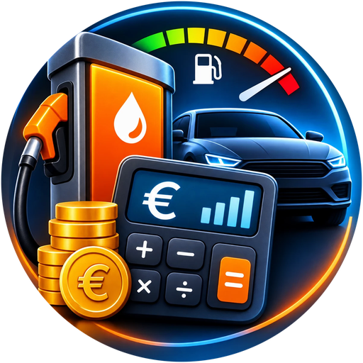
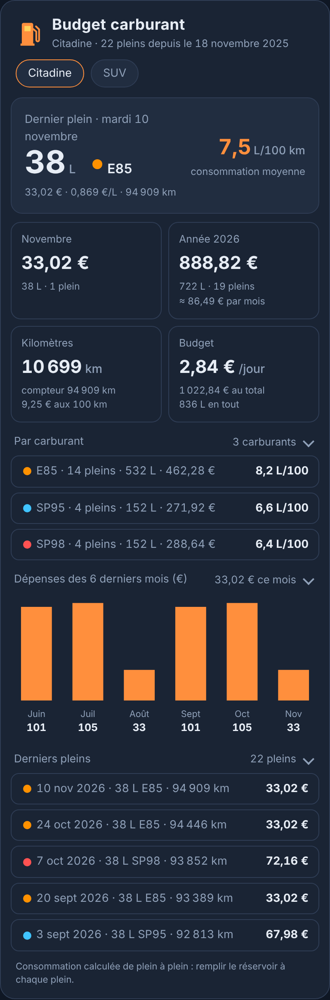
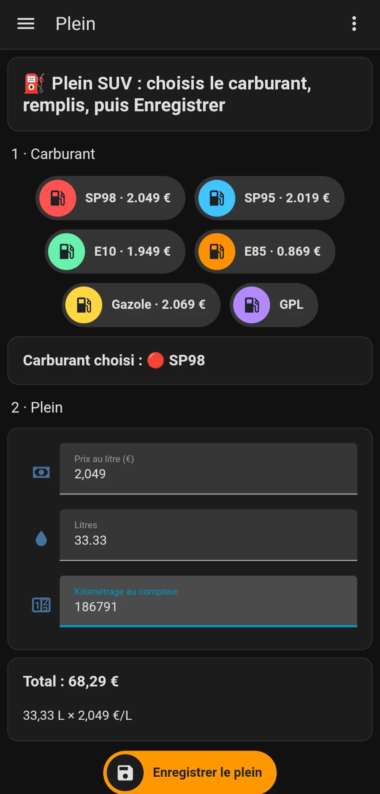

<p>
  ☕ <strong>Si cette carte vous est utile, vous pouvez soutenir le projet :</strong>
</p>

<div style="white-space: nowrap; line-height: 0;">
  <a
    href="https://www.buymeacoffee.com/Marlboro62"
    target="_blank"
    rel="noopener noreferrer"
    style="display: inline-block; text-decoration: none; vertical-align: middle;"
  ></a>&nbsp;&nbsp;<a
    href="https://ko-fi.com/M4M2QL45X"
    target="_blank"
    rel="noopener noreferrer"
    style="display: inline-block; text-decoration: none; vertical-align: middle;"
  ></a>
</div>

# Budget carburant

<p align="center"></p>

Carte Lovelace pour Home Assistant qui suit les pleins de carburant de vos voitures : kilomètres,
consommation moyenne et par carburant, litres, budget par plein, par jour, par mois et par année.

Au plein, on bipe le tag NFC de la voiture avec son téléphone. Une page s'ouvre : on touche le
carburant (le prix du jour se remplit), on tape les litres et le kilométrage, puis « Enregistrer
le plein ». Le plein est noté dans le calendrier, et la carte fait le reste.



*Aperçu réalisé avec la démo : voitures et pleins fictifs.*

**[▶ Essayer la démo en ligne](https://marlboro62.github.io/budget-carburant/docs/demo.html)** :
une année de pleins sur deux voitures, un premier plein, une faute de kilométrage ou aucun plein,
en onglets ou une voiture, sections repliées ou ouvertes, en sombre ou clair, sur téléphone ou PC.
La démo est aussi dans le dépôt : `docs/demo.html`, à ouvrir dans un navigateur.

La page « Plein » qui s'ouvre au bip du tag, sur le téléphone : on touche le carburant (le prix du
jour se remplit), on tape les litres et le kilométrage, puis « Enregistrer le plein ».

<p align="center"></p>

## Ce que contient le dépôt

| Fichier | Rôle |
| --- | --- |
| `budget-carburant-card.js` | la carte `custom:budget-carburant-card`, qui peut installer tout le suivi depuis son éditeur |
| `packages/budget_carburant.yaml` | les entrées, les scripts et l'automatisation du tag NFC (package Home Assistant) |
| `docs/page-plein.yaml` | la page « Plein » que le téléphone ouvre au bip du tag |

Carburants reconnus : SP98, SP95, E10, E85 (éthanol), Gazole et GPL, chacun avec sa couleur.

## Installation de la carte

Dans **Paramètres › Marketplace** (ou HACS avant la 2026.11), ajoutez ce dépôt comme dépôt
personnalisé de type **Tableau de bord** : `https://github.com/Marlboro62/budget-carburant`,
installez **Budget carburant**, puis rechargez la page (Ctrl+F5).

Installation manuelle : copiez `budget-carburant-card.js` dans `/config/www/` et ajoutez la
ressource `/local/budget-carburant-card.js` (type module) dans **Paramètres › Tableaux de bord ›
Ressources**.

## Installation du suivi des pleins depuis la carte (recommandé)

Sans fichier à copier ni redémarrage, avec un compte administrateur :

1. Créez un calendrier local (**Paramètres › Appareils et services › Ajouter une intégration ›
   Calendrier local**) ou gardez le vôtre.
2. Ajoutez la carte à un tableau de bord et ouvrez son éditeur. Sous les options de la carte, la
   partie **Installation du suivi des pleins** demande :
   - vos voitures : nom, tags NFC (par défaut « Plein &lt;nom&gt; »), compteur kilométrique facultatif ;
   - le téléphone par défaut : la page s'ouvre sur le téléphone qui a bipé le tag, celui-ci sert
     seulement si on ne sait pas lequel ;
   - les capteurs de prix du jour de votre station, pour chaque carburant (facultatif) ;
   - le paquet du lanceur Android pour revenir à l'accueil après l'enregistrement (facultatif).
   Si le suivi est déjà installé (à la main ou par une version précédente), **Reprendre l'installation en
   place** remplit ces réglages à partir de l'automatisation existante.
3. Touchez **Installer ou mettre à jour**. La carte crée les entrées, les scripts, l'automatisation
   « Plein de carburant (tag NFC) » et la page « Plein » (`/plein-carburant/choix`), et affiche
   chaque étape.
4. Écrivez un tag NFC par voiture avec l'application Home Assistant (**Paramètres › Tags › Ajouter
   un tag**), avec l'identifiant indiqué pour la voiture.

Pour ajouter une voiture plus tard, ajoutez-la dans l'éditeur et relancez l'installation : les
entrées et les pleins déjà notés sont gardés ; les scripts, l'automatisation et la page sont
réécrits. La page utilise les pastilles de
[maison-chips-card](https://github.com/Marlboro62/maison-ha-cards) si elle est installée, sinon
des cartes de Home Assistant.

## Installation du suivi des pleins en YAML

1. Créez un calendrier local (**Paramètres › Appareils et services › Ajouter une intégration ›
   Calendrier local**) ou gardez le vôtre.
2. Chargez les packages dans `configuration.yaml` :

   ```yaml
   homeassistant:
     packages: !include_dir_named packages
   ```

3. Copiez `packages/budget_carburant.yaml` dans `/config/packages/` et adaptez les lignes marquées
   **À ADAPTER** :
   - les voitures (l'exemple en a deux, « Citadine » et « SUV ») : tags, noms et entrées par voiture ;
   - le calendrier (`calendar.home`) ;
   - le service de notification de votre téléphone (`notify.mobile_app_mon_telephone`) ;
   - les capteurs de prix du jour de votre station (intégration Prix des carburants, par exemple).
4. **Outils › YAML › Vérifier la configuration**, puis redémarrez.
5. Créez la page « Plein » à l'adresse `plein-carburant` avec `docs/page-plein.yaml` (les étapes sont
   en tête du fichier). Ses pastilles viennent de
   [maison-chips-card](https://github.com/Marlboro62/maison-ha-cards).
6. Écrivez un tag NFC par voiture avec l'application Home Assistant (**Paramètres › Tags › Ajouter
   un tag**) en lui donnant l'identifiant du package (`Plein Citadine`, `Plein SUV`…), et collez-le
   dans la voiture.

L'ouverture automatique de la page au bip utilise `command_webview` de l'application Android.
Sur iPhone, touchez la notification pour ouvrir la page.

## La carte

```yaml
type: custom:budget-carburant-card
calendar: calendar.home
```

| Option | Défaut | Rôle |
| --- | --- | --- |
| `calendar` | `calendar.home` | calendrier où chaque plein est noté |
| `prefix` | `Plein` + espace | début du titre des événements, suivi du nom de la voiture |
| `car` | | voiture affichée ; vide : un onglet par voiture |
| `title` | `Budget carburant` | titre de la carte |
| `months` | `6` | mois dans le graphique des dépenses (3 à 12) |
| `history` | `5` | derniers pleins affichés |
| `folded` | `true` | « Par carburant », « Dépenses » et « Derniers pleins » repliés au départ (touchez le titre pour les ouvrir) |
| `theme` | `v2` | `v2` bleu nuit, `auto` bleu nuit ou clair selon Home Assistant, `ha` thème Home Assistant |
| `font_size` | `100` | taille du texte en % |
| `install` | | réglages de l'installation (voitures, téléphone, prix), remplis par l'éditeur |

Toutes les options se règlent aussi dans l'éditeur visuel.

### Ce que la carte affiche

- **Dernier plein** : litres, carburant, prix, prix au litre, kilométrage, et la consommation moyenne.
- **Mois** et **année** : dépense, litres et nombre de pleins ; moyenne par mois après 4 semaines.
- **Kilomètres** : distance suivie, compteur, coût aux 100 km.
- **Budget** : par jour (après 7 jours et deux pleins), total, litres.
- **Par carburant** : pleins, litres, dépense et consommation de chaque carburant.
- **Dépenses des derniers mois** en graphique, puis les **derniers pleins**.

### Comment la consommation est calculée

De plein à plein : les litres d'un plein ont été brûlés sur les kilomètres roulés depuis le plein
précédent, avec le carburant mis à ce plein précédent. Faites le plein complet à chaque fois ; la
consommation apparaît au deuxième plein.

Un kilométrage plus bas que le plein précédent est une faute de frappe : la carte le marque ⚠, ne
le prend pas comme référence et vous invite à corriger l'événement dans le calendrier. Une
consommation hors de 3 à 30 L/100 km n'est pas comptée.

### Format des événements

La carte lit les événements dont le titre commence par « Plein » suivi du nom de la voiture :

```text
Titre       : Plein Citadine
Description : 42.5 L · E85 · 0.869 €/L · 36.93 € · 162000 km
```

Vous pouvez donc aussi ajouter ou corriger un plein à la main dans le calendrier.

## Support

Les questions et les problèmes passent par les
[issues GitHub](https://github.com/Marlboro62/budget-carburant/issues).

## Licence

[MIT](LICENSE)
